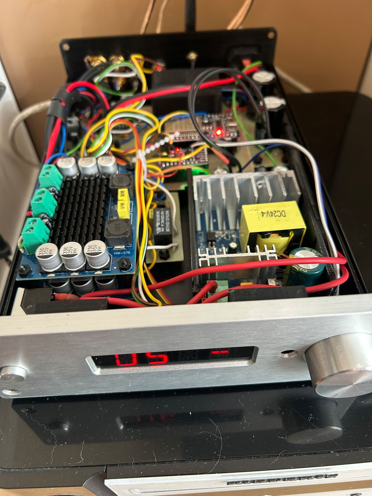
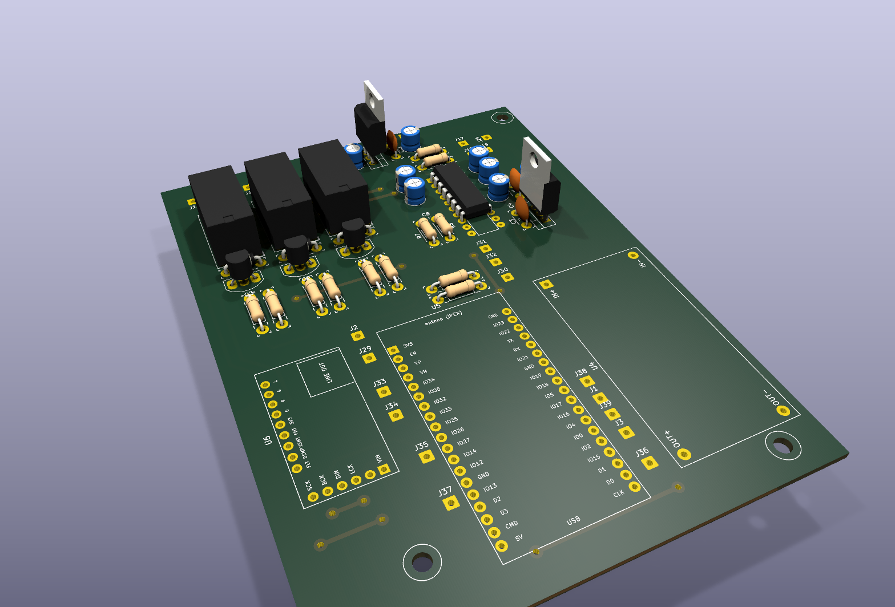
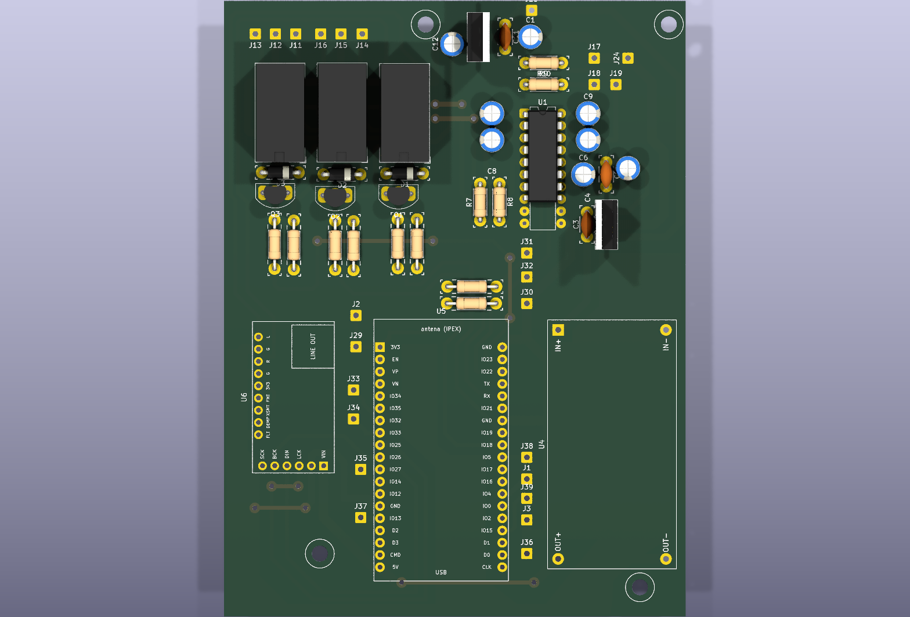
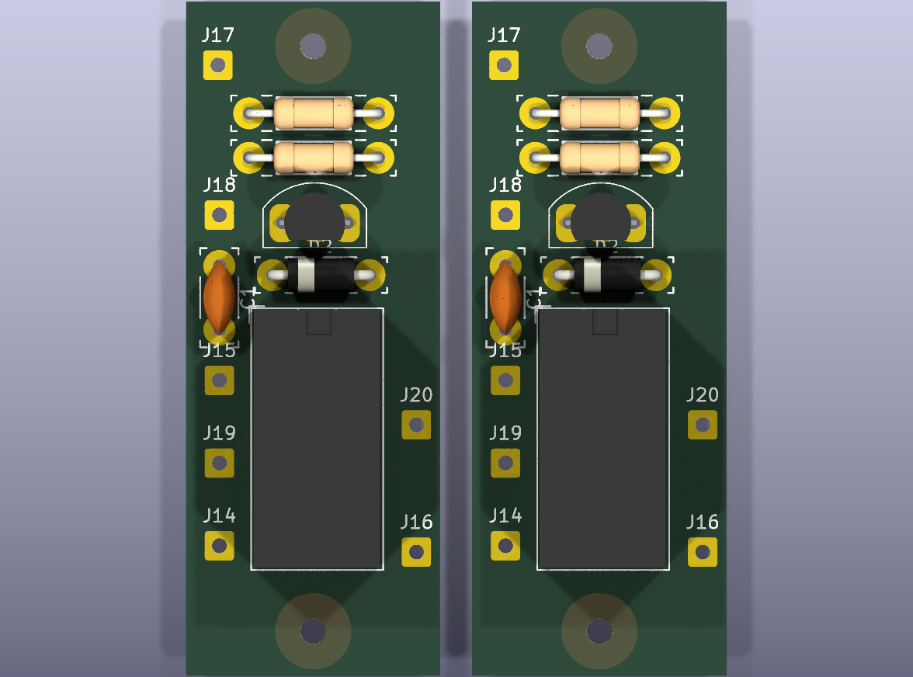

# Audio mini – a small stereo amplifier with Spotify, on an ESP32

*Polska wersja niżej – [przejdź do opisu po polsku](#audio-mini--mały-wzmacniacz-stereo-ze-spotify-na-esp32).*



*Audio mini with the lid off: the class-D amplifier module on the left, the 24 V power supply on the
right, the controller board with the ESP32 at the back, and the 14-segment display and volume knob on
the front panel.*

What I wanted was simple: pick up my phone, choose "Audio mini" in Spotify, and music comes out of my
speakers. TV and the turntable should keep working too, with one knob and one remote for everything,
and no extra box that needs its own app.

So I built a small amplifier that does all of it. Inside the aluminium case there is a class-D
amplifier module (HW-576), a 24 V power supply and the controller board from this repository. The
controller does three jobs: it is a Spotify Connect speaker, it selects the input (Spotify, TV or
Phono) with relays, and it controls the volume with an analog volume chip, so TV and vinyl never pass
through anything digital. The volume knob,
the IR remote, the Spotify app on the phone and a small web page all share the same volume and the same
state. Turn the knob and the slider on your phone moves with it.

It started on a Raspberry Pi. That worked, but a Pi is a whole computer to look after: an SD card, an
operating system, updates, and a slow boot. The ESP32 version starts in a few seconds, needs no
maintenance and costs a fraction of the price.

## What it does in everyday use

- **Spotify on the amplifier.** "Audio mini" shows up in the Spotify app like any Connect speaker
  (Premium account needed). Anyone at home can connect from their own phone and account. The device
  remembers the last login and reconnects by itself after a power cut.
- **Automatic switching.** Press play in Spotify and the amplifier switches to the Spotify input. Switch
  to TV and Spotify pauses on its own.
- **One volume for everything.** Knob, remote, phone and web page change the same analog volume
  (PT2258). Quiet listening gets fine 1 dB steps; the curve can be tuned in the web page.
- **No pops, no thumps.** The speakers sit on their own relay. They connect only after everything is
  powered, the right input is selected and the volume chip has confirmed its settings twice. The same
  happens on every input change.
- **Goes quiet by itself.** On the Spotify input the speakers disconnect after 30 seconds of silence and
  the display shows a dimmed clock. TV and Phono switch off after 3 hours without touching anything;
  press 2 or 3 on the remote to bring them back.
- **A retro display.** Four red 14-segment characters, like an 80s tuner: the clock, the scrolling song
  title and artist, "V 42" while you turn the volume, the input name. On TV and Phono a small dot next to
  the clock tells you which input is on.
- **A remote.** The cheap 21-button IR remote: volume, play/pause, next and previous track, inputs
  1/2/3, mute.
- **A web page.** Open `http://<device-address>:8080` on your phone: now playing with album art,
  volume, inputs, the volume curve and system info (Wi-Fi signal, audio buffer, version).
- **Wi-Fi setup without a computer.** Choose "CONF" in the knob menu, connect your phone to the
  "Audio mini config" network, pick your home network and type the password.
- **Updates over Wi-Fi.** `make ota` builds the firmware and sends it to the device. The case stays
  closed.

## The hardware

| Part | What it does | Connection |
|---|---|---|
| ESP32-DevKitC-VIE (ESP32-WROVER-IE, 8 MB PSRAM, external antenna) | brain, Wi-Fi, Spotify | – |
| PCM5102A DAC module | Spotify audio → analog | I2S: BCK 26, LCK 25, DIN 27 |
| PT2258 | analog volume control | I2C 0x44 (SDA 21, SCL 22) |
| HT16K33 + 4 × 14-segment LED (0.54") | display | I2C 0x70 |
| 3 relays | input selection Spotify / TV / Phono | GPIO 19 / 18 / 23 |
| relay | speakers on/off | ZAP1, GPIO 13 |
| VS1838 IR receiver + 21-button NEC remote | remote control | ZAP2, GPIO 5 |
| EC11 rotary encoder with button | volume and menu | A 32, B 33, button 14 |
| spare connector | for future ideas | ZAP3, GPIO 15 |

KiCad projects are in `pcb/`: `input_selector` is the main board (the schematic is also in PDF) and
`speaker_delay` is the speaker relay board. The images are 3D renders from KiCad; the ESP32, DAC and
power modules have no 3D models, so only their outlines and pin labels are visible.



| Main board (`input_selector`) | Speaker relay boards (`speaker_delay`) |
|---|---|
|  |  |

On the main board, top row: the three input relays with their driver transistors, the PT2258 volume chip
and the regulators for the analog part. Bottom: the PCM5102A DAC module (left), the ESP32 DevKitC
(middle) and the place for an LM2596 converter (U4, right), which I later replaced with a separate
5 V adapter.

### Things I learned the hard way

- **Power the digital part from its own 5 V supply.** With the ESP32 on the same supply as the audio
  part, through a switching converter or a plain linear regulator, Wi-Fi bursts were audible in the
  speakers. A separate 5 V / 2 A adapter made it silent.
- **The DAC is too loud for the PT2258.** The PCM5102A outputs about 2.1 V RMS, more than the PT2258
  input takes at 5 V. The firmware turns Spotify down by 10 dB before the DAC and the PT2258 attenuates
  that channel by 78 dB. On the next board revision I would add a resistor divider after the DAC or run
  the PT2258 from 9 V.
- **Relay coils disturb I2C.** A write to the volume chip right after a relay switched sometimes arrived
  garbled, and the amplifier suddenly got very loud. The firmware now writes all volume settings again,
  twice, just before the speakers connect.
- **GPIO 5 is a strapping pin.** It is pulled high at power-on, so a relay on it switches on before the
  firmware even starts. It is fine for the IR receiver, not for relays.
- **4 MB of flash is tight.** With two firmware slots for Wi-Fi updates there is about 100 KB to spare.
  Next time: a WROVER-IE with 8 or 16 MB.

## Building and flashing

You need [ESP-IDF 5.5](https://docs.espressif.com/projects/esp-idf/) in `~/esp/esp-idf`. Everything else
is handled by the Makefile.

```bash
make            # first run asks for your Wi-Fi, downloads cspot and applies the patches
make flash      # flash over USB (PORT=/dev/cu.usbserial-XXXX if needed)
make ota        # flash over Wi-Fi (ADRES=192.168.1.130 by default)
make monitor    # serial log
make wifi       # change the Wi-Fi network stored at build time
```

The Wi-Fi name and password live only in `sdkconfig.local`, which is not in the repository. A network
set through the "CONF" menu takes priority. You can protect `make ota` with a password in `menuconfig`
(`CONFIG_AUDIO_OTA_HASLO`); by default there is none.

The version number is `PROJECT_VER` in `CMakeLists.txt`. The display shows it for a few seconds after
start, and it is also in `/api/system`.

## Under the hood

The Spotify part isn't mine. It comes from [cspot](https://github.com/feelfreelinux/cspot), an
open-source Spotify client small enough to fit on a chip like the ESP32. The first `make` runs
`setup.sh`, which downloads it and applies my fixes from `patches/`.

Those fixes took most of the time. At first the box would play for a few minutes and then restart on its
own, usually right when I pressed pause or switched to TV. Once I tracked them down, the causes were:

- When you pause, the music fades out over half a second. The fade-out code went one step too far and
  wrote into memory that belonged to something else. That alone explains most of the restarts.
- The audio buffer had its "full" check backwards. When it filled up, bits of sound were cut off and
  the rest slid out of place.
- Every time the connection to Spotify dropped and came back, the part of the program that handles it
  ran out of working memory and crashed.
- The knob, the remote and the web page could all talk to Spotify at the same moment, and the library
  wasn't built for that.
- Right after start, a timer decided Spotify had been silent for ages and hung up.

On a weaker Wi-Fi signal the sound still stuttered. Two changes fixed it: a bigger buffer, now 9 seconds
of music, and switching off a sound-processing step that touched every sample even though it only does
anything during the pause fade-out. The chip was spending a lot of time on it, and decoding barely kept
up.

If you want to poke at it: the web page uses a small JSON API (`/api/status`, `/api/system`,
`/api/wejscie`, `/api/strojenie`, `/api/resety`). `/api/resety` lists the last ten restarts and why they
happened. Without it I would not have found the bugs above.

Code comments are in Polish.

## License

GPL-3.0 (see `LICENSE`), the same license as cspot, which the firmware is built on.

---

# Audio mini – mały wzmacniacz stereo ze Spotify, na ESP32


*Audio mini bez pokrywy: moduł wzmacniacza klasy D z lewej, zasilacz 24 V z prawej, płytka sterownika
z ESP32 z tyłu, a na panelu przednim wyświetlacz 14-segmentowy i gałka głośności.*

Chciałem prostej rzeczy: biorę telefon, wybieram w Spotify „Audio mini” i muzyka gra z moich kolumn.
Telewizor i gramofon mają działać dalej, wszystko z jednej gałki i jednego pilota, bez kolejnego pudełka
z osobną aplikacją.

Zbudowałem więc mały wzmacniacz, który robi to wszystko. W aluminiowej obudowie jest moduł wzmacniacza
klasy D (HW-576), zasilacz 24 V i płytka sterownika z tego repozytorium. Sterownik robi trzy rzeczy: jest
głośnikiem Spotify Connect, przełącza wejścia (Spotify, TV, Phono) przekaźnikami i reguluje głośność
analogowym układem, więc dźwięk z telewizora i z płyty nie przechodzi przez nic cyfrowego. Gałka, pilot,
aplikacja Spotify w telefonie i mała strona WWW mają wspólną głośność i wspólny stan. Kręcisz gałką,
a suwak w telefonie przesuwa się razem z nią.

Zaczęło się od Raspberry Pi. Działało, ale Pi to cały komputer do pilnowania: karta SD, system,
aktualizacje i długi start. Wersja na ESP32 startuje w kilka sekund, nie wymaga obsługi i kosztuje
ułamek ceny.

## Jak to działa na co dzień

- **Spotify na wzmacniaczu.** „Audio mini” pojawia się w aplikacji Spotify jak każdy głośnik Connect
  (potrzebne konto Premium). Każdy domownik może się połączyć ze swojego telefonu i konta. Urządzenie
  pamięta ostatnie logowanie i po zaniku prądu łączy się samo.
- **Samo się przełącza.** Wciskasz „play” w Spotify i wzmacniacz przechodzi na wejście Spotify.
  Przełączasz na TV i Spotify samo się pauzuje.
- **Jedna głośność do wszystkiego.** Gałka, pilot, telefon i strona WWW zmieniają tę samą analogową
  głośność (PT2258). Przy cichym słuchaniu kroki są drobne, po 1 dB; krzywą można dostroić na stronie.
- **Bez stuków i huków.** Kolumny mają własny przekaźnik. Dołączają się dopiero wtedy, gdy wszystko ma
  zasilanie, wybrane jest właściwe wejście, a układ głośności dwa razy potwierdził ustawienia. Tak samo
  przy każdej zmianie wejścia.
- **Samo cichnie.** Na wejściu Spotify po 30 sekundach ciszy kolumny się odłączają, a wyświetlacz pokazuje
  przyciemniony zegar. TV i Phono wyłączają się po 3 godzinach bez dotykania czegokolwiek; przycisk 2
  albo 3 na pilocie włącza je z powrotem.
- **Retro wyświetlacz.** Cztery czerwone znaki 14-segmentowe, jak w tunerze z lat 80.: zegar,
  przewijany tytuł i wykonawca, „V 42” przy kręceniu głośnością, nazwa wejścia. Na TV i Phono mała
  kropka przy zegarze mówi, które wejście jest włączone.
- **Pilot.** Tani pilot na podczerwień z 21 przyciskami: głośność, pauza, następny i poprzedni utwór,
  wejścia 1/2/3, wyciszenie.
- **Strona WWW.** Na telefonie `http://<adres-urządzenia>:8080`: co gra, z okładką, głośność, wejścia,
  krzywa głośności i informacje o systemie (sygnał Wi-Fi, bufor audio, wersja).
- **Ustawienie Wi-Fi bez komputera.** W menu gałki wybierasz „CONF”, łączysz telefon z siecią
  „Audio mini config”, wybierasz swoją sieć i wpisujesz hasło.
- **Aktualizacje przez Wi-Fi.** `make ota` kompiluje program i wysyła go do urządzenia. Obudowa zostaje
  zamknięta.

## Sprzęt

| Element | Do czego | Połączenie |
|---|---|---|
| ESP32-DevKitC-VIE (ESP32-WROVER-IE, 8 MB PSRAM, antena zewnętrzna) | mózg, Wi-Fi, Spotify | – |
| moduł DAC PCM5102A | dźwięk Spotify → analog | I2S: BCK 26, LCK 25, DIN 27 |
| PT2258 | analogowa regulacja głośności | I2C 0x44 (SDA 21, SCL 22) |
| HT16K33 + 4 × LED 14-seg (0,54") | wyświetlacz | I2C 0x70 |
| 3 przekaźniki | wybór wejścia Spotify / TV / Phono | GPIO 19 / 18 / 23 |
| przekaźnik | dołączanie kolumn | ZAP1, GPIO 13 |
| odbiornik IR VS1838 + pilot NEC 21 przycisków | pilot | ZAP2, GPIO 5 |
| enkoder EC11 z przyciskiem | głośność i menu | A 32, B 33, przycisk 14 |
| wolne złącze | na przyszłe pomysły | ZAP3, GPIO 15 |

Projekty KiCad są w `pcb/`: `input_selector` to płyta główna (schemat także w PDF), a `speaker_delay`
to płytka przekaźnika kolumn. Obrazy to widoki 3D z KiCad; moduły ESP32, DAC i zasilania nie mają
modeli 3D, więc widać tylko ich obrysy i opisy pinów.


| Płyta główna (`input_selector`) | Płytki przekaźnika kolumn (`speaker_delay`) |
|---|---|
|  |  |

Na płycie głównej u góry są trzy przekaźniki wejść z tranzystorami, układ głośności PT2258 i stabilizatory
części analogowej. Na dole: moduł DAC PCM5102A (z lewej), ESP32 DevKitC (w środku) i miejsce na
przetwornicę LM2596 (U4, z prawej), którą później zastąpiłem osobnym zasilaczem 5 V.

### Czego nauczyło mnie uruchamianie

- **Część cyfrową zasilaj z osobnego zasilacza 5 V.** Gdy ESP32 był na wspólnym zasilaniu z częścią
  audio, przez przetwornicę impulsową albo zwykły stabilizator liniowy, transmisję Wi-Fi było słychać
  w kolumnach. Osobny zasilacz 5 V / 2 A zrobił ciszę.
- **DAC jest za głośny dla PT2258.** PCM5102A daje około 2,1 V RMS, więcej niż wejście PT2258 przyjmuje
  przy 5 V. Program ścisza Spotify o 10 dB przed DAC, a PT2258 tłumi ten kanał o 78 dB. W następnej
  wersji płytki dałbym dzielnik rezystorowy za DAC albo zasilił PT2258 z 9 V.
- **Cewki przekaźników zakłócają I2C.** Zapis do układu głośności tuż po przełączeniu przekaźnika
  dochodził czasem przekłamany i wzmacniacz nagle grał bardzo głośno. Program wpisuje teraz wszystkie
  ustawienia głośności jeszcze raz, dwukrotnie, tuż przed dołączeniem kolumn.
- **GPIO 5 to pin konfiguracyjny.** Przy włączaniu ma podciąganie do plusa, więc przekaźnik na nim
  włącza się, zanim program w ogóle ruszy. Do odbiornika IR się nadaje, do przekaźników nie.
- **4 MB pamięci flash to mało.** Przy dwóch miejscach na program (aktualizacje przez Wi-Fi) zostaje
  około 100 KB zapasu. Następnym razem: WROVER-IE z 8 albo 16 MB.

## Kompilacja i wgrywanie

Potrzebny jest [ESP-IDF 5.5](https://docs.espressif.com/projects/esp-idf/) w `~/esp/esp-idf`. Resztą
zajmuje się Makefile.

```bash
make            # za pierwszym razem pyta o Wi-Fi, pobiera cspot i nakłada łatki
make flash      # wgranie przez USB (PORT=/dev/cu.usbserial-XXXX, jeśli trzeba)
make ota        # wgranie przez Wi-Fi (domyślnie ADRES=192.168.1.130)
make monitor    # komunikaty z ESP32
make wifi       # zmiana sieci Wi-Fi zapisanej przy kompilacji
```

Nazwa sieci i hasło są tylko w `sdkconfig.local`, którego nie ma w repozytorium. Sieć ustawiona przez
menu „CONF” ma pierwszeństwo. `make ota` można zabezpieczyć hasłem w `menuconfig`
(`CONFIG_AUDIO_OTA_HASLO`); domyślnie hasła nie ma.

Numer wersji to `PROJECT_VER` w `CMakeLists.txt`. Wyświetlacz pokazuje go przez kilka sekund po starcie,
jest też w `/api/system`.

## Pod spodem

Część od Spotify nie jest moja. To [cspot](https://github.com/feelfreelinux/cspot), otwarty klient
Spotify na tyle mały, że mieści się w ESP32. Przy pierwszym `make` skrypt `setup.sh` pobiera go
i nakłada moje poprawki z `patches/`.

Na te poprawki poszło najwięcej czasu. Na początku urządzenie grało kilka minut i samo się restartowało,
najczęściej wtedy, gdy wciskałem pauzę albo przełączałem na telewizor. Przyczyny okazały się takie:

- Przy pauzie muzyka cichnie przez pół sekundy. Kod tego wyciszania robił o jeden krok za dużo
  i zapisywał w pamięci, która należała do czegoś innego. To tłumaczy większość restartów.
- Bufor dźwięku miał odwrotnie sprawdzane, czy jest pełny. Gdy się zapełnił, kawałki muzyki były
  ucinane, a reszta się rozjeżdżała.
- Za każdym razem, gdy połączenie ze Spotify zrywało się i wracało, części programu, która się tym
  zajmuje, brakowało pamięci roboczej i padała.
- Gałka, pilot i strona WWW mogły odezwać się do Spotify w tej samej chwili, a biblioteka nie była na
  to przygotowana.
- Zaraz po starcie licznik uznawał, że Spotify od dawna milczy, i rozłączał.

Przy słabszym Wi-Fi dźwięk dalej się zacinał. Pomogły dwie zmiany: większy bufor, teraz na 9 sekund
muzyki, i wyłączenie przetwarzania dźwięku, które obrabiało każdą próbkę, choć do czegokolwiek jest
potrzebne tylko przy wyciszaniu na pauzę. Procesor tracił na nie sporo czasu i dekodowanie ledwo
nadążało.

Jeśli chcesz pogrzebać: strona WWW korzysta z małego API w JSON (`/api/status`, `/api/system`,
`/api/wejscie`, `/api/strojenie`, `/api/resety`). `/api/resety` pokazuje dziesięć ostatnich restartów
z przyczyną. Bez niego tych błędów bym nie znalazł.

Komentarze w kodzie są po polsku.

## Licencja

GPL-3.0 (plik `LICENSE`), ta sama licencja co cspot, na którym opiera się program.
